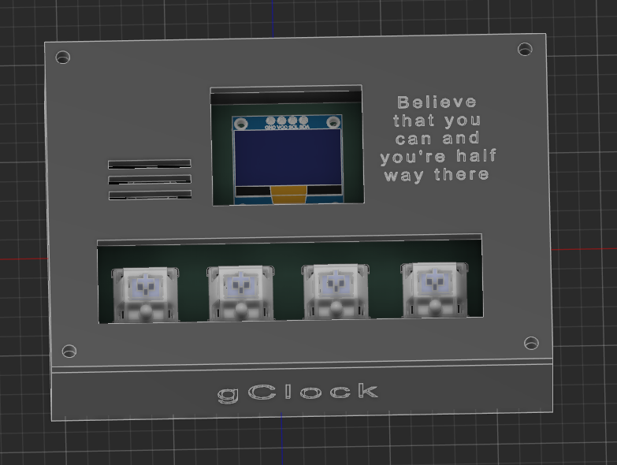
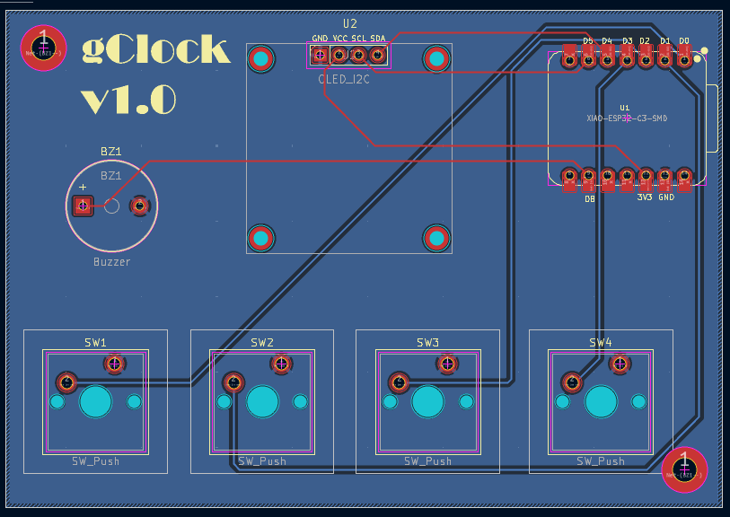
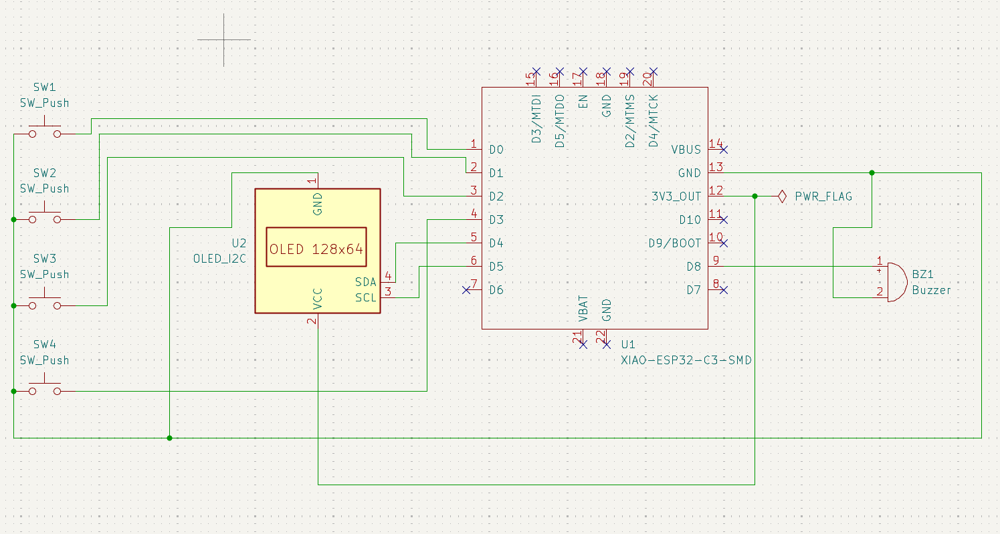
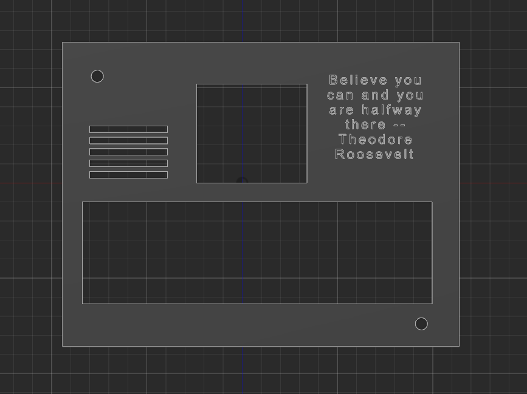
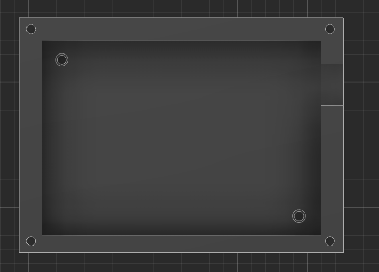
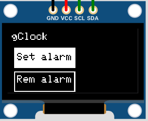
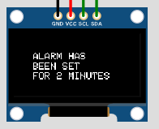
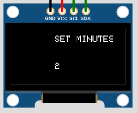

# gClock -- Simple and Reliable

### gClock is a simple alarm clock, powered by an ESP32C3. It features functions as:

* Setting an alarm
* Removing an alarm
* Setting minutes until the alarm
* more in future versions

## Specifications
 - 4 Cherry MX Switches
 - 1 buzzer
 - Seeed Studio ESP32C3
 - SSD1306 128x64 0.91inch display
 - 3D modeled enclosure
 - Custom firmware
## Plans to upgrade
* Add a functionality for the user to choose a melody
* Add a snooze and stop alarm functions (now it just rings for set amount of seconds)
* Make a more futuristic design
## Screenshots of the project
### PCB design

### Schematic

### Top Part

### Bottom Part

### Main Menu

### Set alarm Menu

### Set minutes Menu

